<!-- ================= HEADER ================= -->
<p align="center">
  
</p>

<!-- typing:start -->
<p align="center">
  <a href="https://lonkodev.cl">
    
  </a>
</p>
<!-- typing:end -->

<p align="center">
  <a href="https://lonkodev.cl"></a>
  <a href="https://www.tiktok.com/@lonkodev"></a>
  <a href="https://www.instagram.com/lonkodev/"></a>
  <a href="https://www.linkedin.com/in/lonkodev/"></a>
  <a href="https://www.youtube.com/@lonkodevcl"></a>
</p>

<p align="center">
  
</p>

---

## `> whoami`

```php
<?php

class LonkoDev
{
    public string $nombre    = 'Giovanni Cáceres Rubio';
    public string $base      = 'Rancagua / Doñihue, Chile 🇨🇱';
    public array  $roles     = ['Full-Stack Dev', 'Docente IP Santo Tomás', 'Creador de contenido tech'];
    public array  $hago      = ['Apps web y mobile', 'Automatización de procesos', 'Transformación digital municipal'];
    public array  $enseño    = ['Patrones de Diseño', 'Estructuras de Datos', 'Programación Web', 'Computación en la Nube'];
    public string $filosofia = 'Si no resuelve un problema real, no se programa.';

    public function contratar(): string
    {
        return 'Consultoría · Freelance · Clases → lonkodev.cl';
    }
}
```

---

## `> ls ./proyectos --en-produccion`

### 🏛️ Gobierno local

| | Proyecto | De qué se trata | Stack |
|:-:|---|---|---|
| 📱 | **Doñihue Conectado** | App móvil oficial para que los vecinos se informen y hagan trámites | Ionic · React · TypeScript · Firebase · Capacitor |
| 🌐 | **Web Municipal 2.0** | Sitio institucional rehecho desde cero, rápido y accesible | Laravel 13 · Vue · Tailwind |
| 🛡️ | **Odin** | Portal central de accesos: un login y permisos para todas las apps | Laravel 13 · Login Microsoft · Tailwind |
| 📨 | **JARL** | Solicitudes y asignación de tareas para el equipo de comunicaciones | Laravel 12 · Login Microsoft · Tailwind · Alpine.js |
| 🤝 | **RUNA** | Registro unificado de ayudas sociales, adiós planillas sueltas | Laravel 13 · Tailwind |
| 🗂️ | **SIGD** | Gobernanza de datos: qué datos hay, dónde viven y quién responde | Laravel 13 · Vue · Inertia · Login Microsoft · MySQL |
| 📋 | **coreCPAT** | Caracterización de procesos internos y reportería | Laravel 13 · Tailwind |
| ⚙️ | **Asgard** | Panel de administración que alimenta la app y la web | Vue · TypeScript · Firebase |
| 💬 | **Heimdal** | Plataforma para crear y administrar chatbots de atención ciudadana | Laravel 13 · Vue · Inertia · Login Microsoft · MySQL |
| 🌈 | **Biofrost** | Monitoreo de disponibilidad de los servicios web | Laravel 12 · Vue · Inertia · Tailwind |
| 🎭 | **Astrid** | Reportes mensuales de talleres culturales y deportivos | Laravel 13 · Tailwind · Alpine.js · PDF |
| 🎓 | **Becas** | Postulación y seguimiento de becas en línea | Laravel 12 · Tailwind · MySQL |
| 🦉 | **Munin** | Anonimiza PDFs en el navegador, sin subir el archivo a ningún lado | JavaScript · pdf-lib · PDF.js |
| 📊 | **Dashboard SIMCE** | Resultados educativos de la comuna en gráficos simples | Vue · Firebase |

### 🍎 Educación

| | Proyecto | De qué se trata | Stack |
|:-:|---|---|---|
| 📝 | **Skald** | Notas, asistencia y décimas para docentes, sin Excel | Laravel 11 · Vue · Inertia · Tailwind |
| 🏫 | **Matrículas República** | Proceso de matrícula escolar 100% en línea | Laravel 13 · Login Microsoft · Tailwind |
| 🎮 | **DEVDEX** | Demo para alumnos: de local a producción usando agentes de IA | Vue · PHP · PokéAPI |

### 💼 Freelance

| | Proyecto | De qué se trata | Stack |
|:-:|---|---|---|
| 🥋 | **Taebek System** | Sitio, inscripciones y panel de gestión para una academia deportiva | Laravel 12 · Tailwind · Alpine.js |
| 🚌 | **RUNE** | Cotizador para una empresa de transporte | Laravel · MySQL |
| 🧾 | **Facturas** | Registro y seguimiento de facturas | Laravel 13 · Tailwind · SQLite |

> 🔒 Casi todos son sistemas en producción con repos privados. Si quieres saber más de alguno, [escríbeme](https://lonkodev.cl).

---

## `> cat stack.json`

<p align="center">
  <br/>
  
</p>

---

## `> git log --stats`

<p align="center">
  
</p>

<p align="center">
  
</p>

<p align="center">
  
</p>

---

## `> ./contenido.sh`

Hago contenido tech en español chileno, cercano y sin humo:

- `>` **Git y GitHub** sin miedo (el video que me trajo hasta acá 😅)
- `>` **SQL, POO y patrones de diseño** explicados como en clase, pero en 60 segundos
- `>` **Cloud y automatización** aplicados a casos reales
- `>` **Vida de dev en Chile**: la muni, la sala de clases y los proyectos freelance

👉 Encuéntrame como **@lonkodev** en TikTok e Instagram.

---

## `> contacto --ahora`

<p align="center">
  <b>¿Necesitas un sistema, automatizar un proceso o una clase/taller para tu equipo?</b><br/><br/>
  <a href="https://lonkodev.cl"></a>
</p>

---

<p align="center">
  <picture>
    <source media="(prefers-color-scheme: dark)" srcset="https://raw.githubusercontent.com/lonkodev/lonkodev/output/snake-dark.svg" />
    
  </picture>
</p>

<p align="center">
  
</p>
